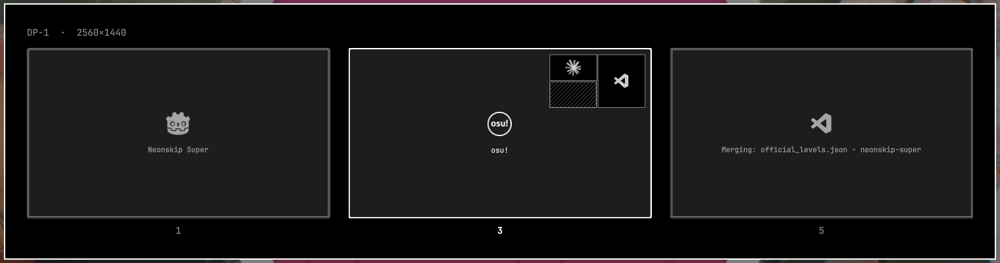
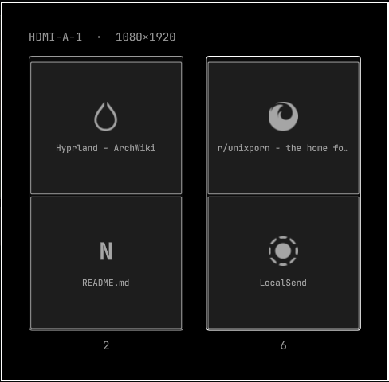

# Omarchy Desktops+

Multi-monitor workspaces for [Omarchy](https://omarchy.org): a bar that knows which monitor each
workspace lives on, workspaces that stay on their monitor, an overview of every workspace, and a
compact bar on secondary monitors.


Requires Omarchy 4 (Quickshell shell, Lua Hyprland config). Tested with any number of monitors.

## What's in it

### Workspaces (`desktops-plus.workspaces`)


Each monitor's bar marks workspaces relative to *that* monitor:

| Mark | Meaning |
|------|---------|
| underline | the workspace has windows on this monitor |
| dot | the workspace lives on this monitor but is empty |
| large square | the workspace on screen on this monitor |
| small square | the workspace on screen on another monitor |
| dimmed number | empty, or lives on another monitor |

- Workspaces **1–5** always exist and remember their monitor, even when empty. Workspaces **6+**
  close when empty, like stock Omarchy, but still come back on the monitor they were last on.
- Unplug a monitor and its workspaces move to another one; plug it back in and they go home.
- **Overview** (`SUPER+SHIFT+ALT+SPACE`): every monitor shows its own workspaces with each window
  drawn at its real position, with its app icon and title. Click a workspace or window to jump to
  it, press `1`–`0` to switch, double middle-click a window to close it, `Esc` to dismiss.
  Fullscreen workspaces show a minimap of the windows behind them, with the fullscreen app's own
  tile hatched.



Above: side-by-side tiles (1, 5), a three-way split (7), and osu! fullscreen (3) with
the minimap of the terminal and browser behind it. Each monitor gets its own overview; on a
vertical 1080×1920 monitor the cards follow its proportions:



Icons come from [Simple Icons](https://simpleicons.org): the app itself, what's running inside a
terminal (btop, nvim…), or the site named in a browser tab's title (YouTube, Hyprland…), falling back to the browser.

### Keybindings

| Keys | Action |
|------|--------|
| `SUPER+SHIFT+ALT+SPACE` | Workspace overview |
| `SUPER+ALT+1…0` | Renumber the active workspace (swaps with the target if it has windows), keeping its monitor |
| `SUPER+ALT+arrows` | Move the active workspace to the monitor in that direction |

These replace Omarchy's `SUPER+ALT+number` (focus group window) and `SUPER+ALT+arrows` (move
into group) and unbind `SUPER+SHIFT+ALT+number/arrows`. Skip the `dofile` line the installer
adds to `~/.config/hypr/bindings.lua` if you'd rather keep those.

### Bar (`desktops-plus.bar`)

Omarchy's bar with two additions in `~/.config/omarchy/shell.json`:

```json
"bar": {
  "id": "desktops-plus.bar",
  "primaryMonitor": "DP-1",
  "secondaryLayout": {
    "left": ["desktops-plus.clock"],
    "center": ["desktops-plus.workspaces"],
    "right": ["desktops-plus.system-stats"]
  }
}
```

- `secondaryLayout`: widgets shown on every monitor except the primary one (they must also be in
  the main `layout`). Leave it out to get the full bar on every monitor.
- `primaryMonitor`: the output that gets the full bar (`hyprctl monitors` lists names). Leave it
  out to use the top-left monitor.
- `locked`: `true` stops widgets from being dragged around and the bar from being dragged to
  another edge. The `desktops-plus.bar-lock` padlock toggles it.

The side groups of the center section are also centered between the bar edge and the anchor
widget, instead of hugging it.

### Widgets

| Plugin | Change from stock |
|--------|-------------------|
| `desktops-plus.clock` | Ticks every second, so formats can include seconds |
| `desktops-plus.weather` | Temperature, humidity and rain chance as text on the bar |
| `desktops-plus.system-stats` | CPU / GPU / RAM usage and temperatures; panel with power draw, clocks, VRAM, disk. Works with AMD and Intel CPUs, NVIDIA (`nvidia-smi`) and AMD GPUs |
| `desktops-plus.audio` | Changing the output moves playing streams along, except voice chat apps (Vesktop, Discord), which stay put. Edit `keep_apps` in `bin/output-set-default` |
| `desktops-plus.tray` | Tray icons always shown instead of hidden behind a hover drawer |
| `desktops-plus.keyboard-layout`, `.system-update` | Text at body size, like the rest of the bar |
| `desktops-plus.bar-lock` | New: padlock next to the indicators that locks the bar layout |

## Install

```bash
git clone https://github.com/EamForexon/omarchy-desktops-plus.git
cd omarchy-desktops-plus
./install.sh
```

The installer backs up `shell.json` and `hypr/bindings.lua`, copies the plugins into
`~/.config/omarchy/plugins`, applies the bar layout in `presets/bar.json`, adds the keybindings,
downloads [Simple Icons](https://simpleicons.org) for the overview, and restarts the shell.

- `./install.sh --keep-layout`: keep your bar layout; only swap in the bar and workspaces widget.
- `./install.sh --link`: symlink instead of copy, to hack on a checkout.
- `./install.sh --uninstall`: remove everything and restore the first backup.

Update with `git pull && ./install.sh`.

Optional, for RAM speed and measured CPU power in the stats panel (caches the RAM speed and makes
the RAPL energy counter readable on boot):

```bash
sudo ~/.config/omarchy/plugins/desktops-plus.system-stats/bin/root-sensors-setup
```

## Notes

- The bar and widgets are forks of Omarchy's built-in plugins. After a big Omarchy update, if
  something looks off, `./install.sh --uninstall` gets you back to stock.
- Workspace placement is saved in `~/.local/state/desktops-plus/workspace-monitors.json`.
- The number of always-present workspaces is `5`, set in `Workspaces.qml` (`alwaysShown`) and
  `Service.qml` (`keepAlive`).

## License

MIT. Parts derived from [Omarchy](https://github.com/basecamp/omarchy) (MIT).
